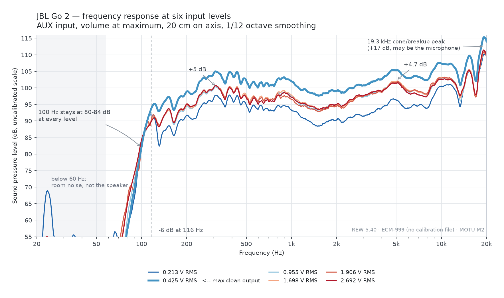
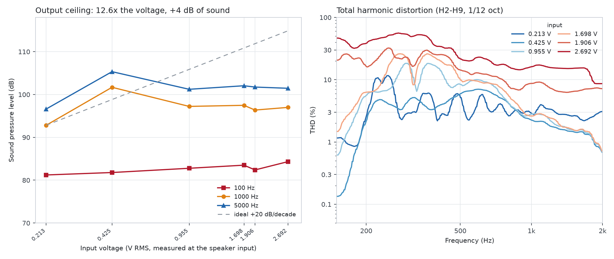

# Speaker measurements

Frequency response, distortion and output-limit measurements of small Bluetooth
speakers, made with [Room EQ Wizard](https://www.roomeqwizard.com/) (REW) in an
ordinary room. Raw `.mdat` files, exported text data and the scripts that produce
the figures are all included, so every number here can be traced back to a sweep.

| Device | Measured | Input levels | Folder |
|---|---|---|---|
| JBL Go 2 | 2026-11-22 | 0.213 – 2.692 V RMS (6 steps) | [`measurements/jbl-go-2/`](measurements/jbl-go-2/) |

## JBL Go 2 — what the data shows



- **Bass ends at about 116 Hz.** The response is −6 dB at 116 Hz and −10 dB at
  105 Hz, relative to the 300 Hz – 3 kHz average. Below 60 Hz nothing above the
  room noise floor comes out of the speaker at all.
- **The midband is reasonably flat**: within ±1.5 dB from 300 Hz to 1 kHz, with a
  +5 dB lift around 315 Hz and a shallow −2 dB dip near 1.6 kHz.
- **The top end is bright**: +4.7 dB at 5 kHz, +6.6 dB at 10 kHz and a narrow
  +17 dB peak at 19.3 kHz.
- **100 Hz does not get louder.** It sits at 80.0 – 84.3 dB at every input level
  (4.3 dB spread), while 1 kHz moves 8.9 dB over the same set. The bass is capped
  by excursion, not by the volume setting.
- **Clean output tops out at 101.7 dB @ 1 kHz (0.425 V input, 2.2% THD).** Raising
  the input 12.6× (+22 dB) adds 4 dB of level, and above 0.43 V the output actually
  drops back 4–5 dB and stays at 96–97 dB.
- **Distortion explodes past the limiter.** 2.2% at 0.425 V, 8.7% at 1.906 V, 16.0%
  at 2.692 V (1 kHz), reaching 21% at 500 Hz and 38% at 200 Hz. Odd harmonics
  dominate (H3 ≈ 15% vs H2 ≈ 4% at 1 kHz), i.e. hard symmetric limiting.



A full table of the six levels, the exact conditions and the caveats are in
[`measurements/jbl-go-2/`](measurements/jbl-go-2/).

## How these were measured

Short version: REW 5.40, 256k logarithmic sine sweep, 48 kHz, one sweep at 0 dBFS,
no timing reference; ECM-999 microphone on axis at 20 cm, MOTU M2 interface; AUX
input with the speaker volume fixed at maximum; input voltage measured with a
multimeter (RMS) at the speaker terminals. Full details, including what was *not*
done, are in [method.md](method.md).

## Read this before quoting the numbers

- **The SPL scale is not calibrated.** No SPL meter was used, so the REW offset
  (120.0 dB) is arbitrary. Relative differences are meaningful; absolute values
  are not, and should not be compared against manufacturer specifications.
- **The microphone has no calibration file.** Above roughly 2 kHz the fine detail
  — including the 19.3 kHz peak — may belong to the microphone rather than to the
  speaker.
- One unit, one listening position, no off-axis data. Repeatability between two
  sweeps one minute apart is 0.3 dB (120–300 Hz), 0.6 dB (300 Hz–1 kHz) and about
  1.5 dB (1–10 kHz).

## Repository layout

```
measurements/<device>/     one folder per speaker: raw .mdat, exported data, figures
scripts/mdat_reader.py     pure-python reader for REW .mdat files
scripts/export_data.py     .mdat  ->  text + CSV
scripts/plot.py            CSV   ->  figures
method.md                  how the measurements were made
```

## Reproducing the figures

```bash
pip install numpy matplotlib
python scripts/export_data.py
python scripts/plot.py
```

## License

Measurement data, figures and text: [CC BY 4.0](LICENSE) — use them, just say
where they came from. Scripts: [MIT](LICENSE-MIT).

中文版说明见 [README.zh-CN.md](README.zh-CN.md)。
