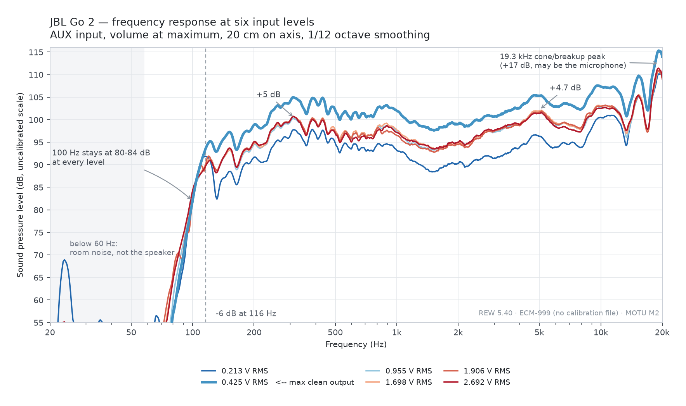
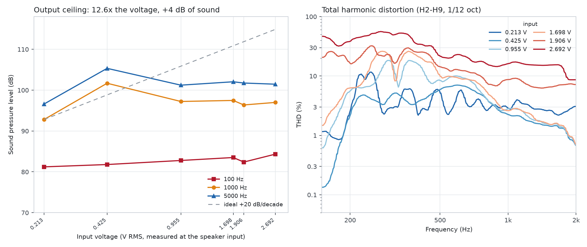

[English](README.md) | **中文**

# 扬声器实测数据

用 [REW](https://www.roomeqwizard.com/) 在普通房间里测的小型蓝牙音箱频响、失真和输出上限。
原始 `.mdat`、导出的文本数据和出图脚本都在仓库里，任何一个数字都能追回到某一次扫频。

| 设备 | 测量日期 | 输入电平 | 目录 |
|---|---|---|---|
| JBL Go 2 | 2026-11-22 | 0.213 – 2.692 V RMS（6 档） | [`measurements/jbl-go-2/`](measurements/jbl-go-2/) |

## JBL Go 2：这组数据说了什么



- **低频到 116 Hz 就没了。** 相对 300 Hz – 3 kHz 平均值，116 Hz 处 −6 dB，105 Hz 处 −10 dB。
  60 Hz 以下喇叭什么都推不出来，曲线那一截是房间噪声。
- **中频还算平**：300 Hz – 1 kHz 在 ±1.5 dB 内，315 Hz 有 +5 dB 的隆起，1.6 kHz 有个 −2 dB 的浅坑。
- **高频偏亮**：5 kHz +4.7 dB，10 kHz +6.6 dB，19.3 kHz 有个 +17 dB 的窄峰。
- **100 Hz 加不上去。** 六个输入电平下它都停在 80.0 – 84.3 dB（只差 4.3 dB），
  而 1 kHz 在同一组里变了 8.9 dB。低频是被冲程卡死的，不是音量没开够。
- **最干净的满输出是 101.7 dB @ 1 kHz**（0.425 V 输入，THD 2.2%）。输入电压再加 12.6 倍（+22 dB），
  声压只多 4 dB；超过 0.43 V 之后反而回落 4–5 dB，横在 96–97 dB。
- **过了限幅器失真暴涨**：0.425 V 时 2.2%，1.906 V 时 8.7%，2.692 V 时 16.0%（1 kHz），
  500 Hz 到 21%，200 Hz 到 38%。奇次谐波占主导（1 kHz 时 H3≈15%、H2≈4%），
  说明是对称硬削波。



六档电平的完整表格、测量条件和注意事项都在 [`measurements/jbl-go-2/`](measurements/jbl-go-2/)。

## 怎么测的

简述：REW 5.40，256k 对数扫频，48 kHz，一次扫频 0 dBFS，无时间参考；ECM-999 麦克风轴上 20 cm，
MOTU M2 声卡；AUX 输入，音箱音量旋钮固定在最大；输入电压用万用表在音箱输入端实测（RMS）。
完整参数、以及**哪些没做**，见 [method.md](method.md)。

## 引用这些数字之前

- **声压刻度没有校准。** 没用声压计做过 SPL 校准，REW 里那个 120.0 dB 的偏移是随手填的。
  相对差异有意义，绝对值没有，更不要拿去跟厂家标称比。
- **麦克风没有校准文件。** 大约 2 kHz 以上，细节（包括 19.3 kHz 那个峰）可能来自麦克风而不是音箱。
- 单只样品、单一位置、没有离轴数据。相隔一分钟的两次测量重复性是：120–300 Hz 0.3 dB，
  300 Hz – 1 kHz 0.6 dB，1–10 kHz 约 1.5 dB。

## 目录结构

```
measurements/<设备>/       每只音箱一个目录：原始 .mdat、导出数据、图片
scripts/mdat_reader.py     纯 Python 读取 REW .mdat
scripts/export_data.py     .mdat  ->  文本 + CSV
scripts/plot.py            CSV    ->  图片
method.md                  测量方法
```

## 复现图片

```bash
pip install numpy matplotlib
python scripts/export_data.py
python scripts/plot.py
```

## 许可

测量数据、图片和文字：[CC BY 4.0](LICENSE)，随便用，注明出处即可。脚本：[MIT](LICENSE-MIT)。
