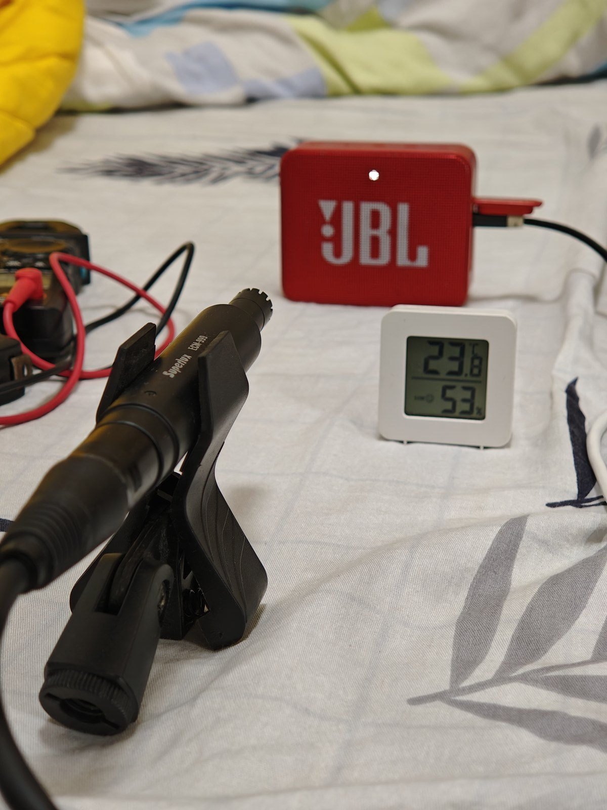
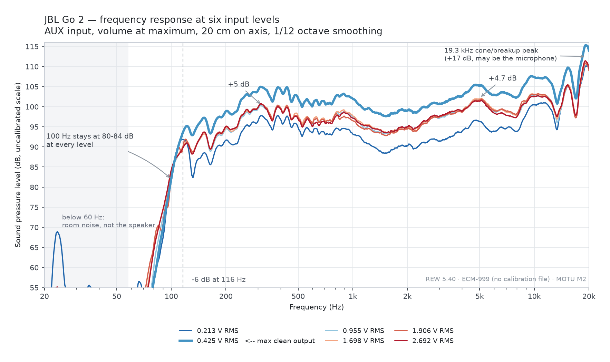

# JBL Go 2 — measurements

One unit, measured 2026-11-22 in an ordinary room. Conditions, equipment and
everything that was *not* done: [../../method.md](../../method.md).



*Speaker and microphone in place, 20 cm on axis. Photo from the same session.*



## Results per level

| Input (V RMS) | SPL @1 kHz | SPL @100 Hz | SPL @500 Hz | SPL @5 kHz | THD @200 Hz | THD @500 Hz | THD @1 kHz | Worst THD 150 Hz–10 kHz | SNR | SDR |
|---|---|---|---|---|---|---|---|---|---|---|
| 0.213 | 92.8 | 81.2 | 95.2 | 96.6 | 2.6% | 5.4% | 2.8% | 12.6% | 48.8 dB | 33.5 dB |
| 0.425 | **101.7** | 81.8 | 102.7 | 105.3 | 2.2% | 5.9% | **2.2%** | 7.1% | 61.0 dB | 49.2 dB |
| 0.955 | 97.2 | 82.8 | 97.8 | 101.2 | 5.6% | 8.5% | 2.8% | 18.9% | 56.8 dB | 48.6 dB |
| 1.698 | 97.5 | 83.5 | 98.3 | 102.0 | 6.3% | 9.8% | 2.6% | 26.8% | 55.4 dB | 48.4 dB |
| 1.906 | 96.4 | 82.4 | 98.0 | 101.7 | 15.6% | 14.2% | 8.7% | 34.0% | 35.5 dB | 45.9 dB |
| 2.692 | 97.0 | 84.3 | 97.6 | 101.5 | 37.9% | 21.3% | 16.0% | 57.1% | 47.1 dB | 15.9 dB |

SPL figures are on the uncalibrated REW scale — see [../../method.md](../../method.md).
"Worst THD" is the maximum of the 150 Hz – 10 kHz curve, which lands near 130–200 Hz.

## What it adds up to

**1. Bass stops at ~116 Hz.** −6 dB at 116 Hz, −10 dB at 105 Hz relative to the
300 Hz – 3 kHz median (95.5 dB). The slope from 80 Hz to 125 Hz is about 45 dB/oct
on average, far steeper than any sealed box — there is a high-order high-pass
working here, plus a tuning bump around 125 Hz.

**2. The bass has a hard ceiling at ~82 dB.** Across the six levels the output at
100 Hz spans 80.0 – 84.3 dB, while 1 kHz spans 92.8 – 101.7 dB. Turning it up makes
the midrange louder and leaves the bass where it was, so the tonal balance gets
thinner the louder it plays.

**3. Clean output is 101.7 dB @ 1 kHz, and that is the end of it.** 12.6× more input
voltage adds 4 dB. Past 0.43 V the level actually falls back and stays at 96–97 dB
while distortion climbs — the limiter is holding the output down and paying for it
in harmonics.

**4. Distortion is worse at low frequencies and grows fast.** At 0.425 V, 5.9% at
500 Hz and 2.2% at 1 kHz. At 2.692 V, 21% and 16%, and 38% at 200 Hz. Odd harmonics
dominate throughout — at 1 kHz, H3 ≈ 15% against H2 ≈ 4% — which is the signature of
symmetric hard limiting rather than gentle compression.

**5. Above 2 kHz the speaker stays clean much longer.** At 0.955 V the distortion
above 2 kHz is below 0.6%; the 2.692 V sweep still shows 10–15% between 5 and 8 kHz.
The mid-bass gives up first.

**6. It is repeatable in the midband and not in the bass.** Two sweeps one minute
apart differ by 0.3 dB (120–300 Hz), 0.6 dB (300 Hz – 1 kHz) and about 1.5 dB
(1–10 kHz); below 60 Hz they differ by 6.8 dB, but that region is room noise anyway.

## Files

```
raw/jbl-go-2_6levels_2026-11-22.mdat   all six measurements, as saved by REW
data/jbl-go-2_<voltage>V.txt           frequency / SPL / phase per level
data/jbl-go-2_levels.csv               one column of SPL per level, common axis
data/jbl-go-2_thd.csv                  THD per level, 150 Hz - 10 kHz
data/summary.csv                       the table above, machine readable
img/*.png                              figures, regenerated by scripts/plot.py
```
