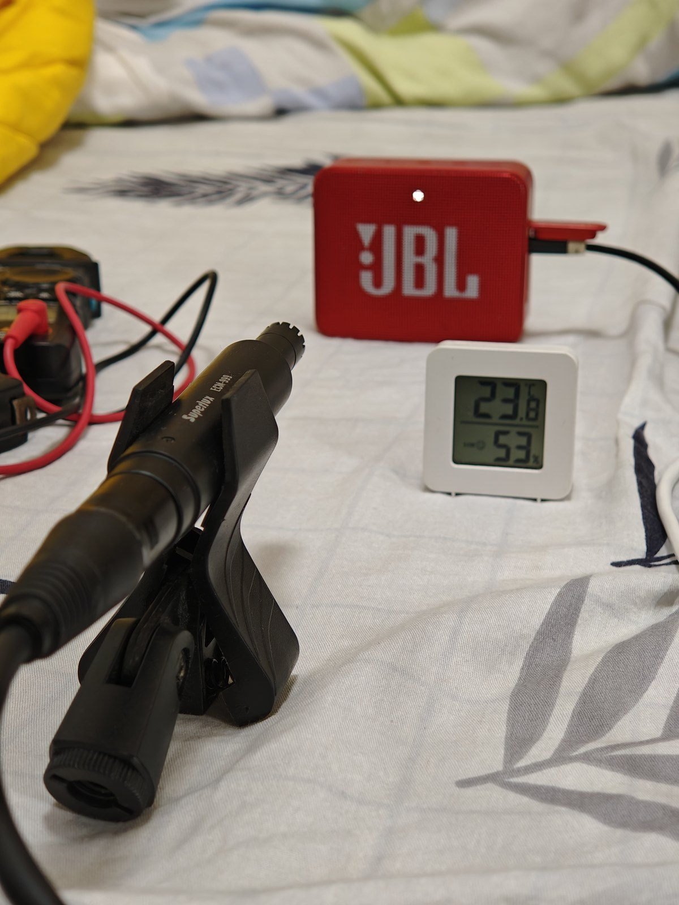

# Method

Everything here is also stored inside the `.mdat` files — this page just makes it
readable without REW.

*The speaker on its normal spot, microphone on axis at 20 cm. Photo taken during
the 2026-11-22 session.*

## Equipment

| Item | Detail |
|---|---|
| Loudspeaker | JBL Go 2, single unit, factory firmware, no modifications |
| Source | AUX (3.5 mm) input, speaker volume fixed at maximum for the whole session |
| Interface | MOTU M2, ASIO driver, output 1 → speaker, input 1 ← microphone |
| Microphone | ECM-999 (old, uncalibrated), on axis, 20 cm from the front grille |
| Software | Room EQ Wizard 5.40 beta 120, Java 11.0.30, Windows 10 |
| Room | Ordinary untreated room (no acoustic treatment), 23.8 °C / 53% RH (indicative) |
| Input level | Multimeter at the speaker input, RMS, 1 kHz |

## Placement

The speaker sat on its usual spot in an ordinary room, with no stand and no
treatment behind or around it. The microphone was aimed at the speaker from 20 cm,
on axis. Allow ±1–2 cm on that distance — that alone is ±0.5–0.9 dB of level.

Two things follow from this arrangement:

- At 20 cm the microphone is close enough that the room contributes less than it
  would at 1 m, but reflections off the desk and the wall behind the speaker are
  still in the measurement, and they are not windowed out.
- A 20 cm measurement reads about **14 dB higher** than the same speaker at 1 m
  (20·log₁₀(0.2)). That conversion is geometry, not calibration.

## REW settings

| Parameter | Value |
|---|---|
| Signal | 256k logarithmic sine sweep, 1 sweep at 0 dBFS |
| Timing reference | none (no loopback) |
| Sample rate | 48 kHz |
| Points | 59 443 |
| Range | 0.34 Hz – 20 kHz, 0.336 Hz spacing |
| Smoothing in REW | none — smoothing is applied by `scripts/plot.py` |

Without a timing reference the magnitude response is still correct; only the
absolute delay, and therefore the absolute phase offset, is arbitrary. Phase is
exported but should be read as relative.

## Level series

Volume was set to maximum once and never touched. Input voltage was changed
between sweeps and measured at the speaker input:

`0.213 / 0.425 / 0.955 / 1.698 / 1.906 / 2.692 V RMS`

The point of the series was to find where the speaker stops getting louder. It
brackets that point to between 0.43 V and 0.96 V — a 7 dB window — and does not
resolve it further.

## What was not done

- **No SPL calibration.** The 120.0 dB offset stored in the files is arbitrary.
  Every dB value here is on an "as measured" scale: differences between curves and
  between frequencies are valid, absolute levels are not.
- **No microphone calibration file.** Expect a few dB of error above 2 kHz that
  belongs to the microphone. The 19.3 kHz peak is where this matters most.
- **No measured room dimensions.** The 5 × 4 × 2.4 m values in the file are REW's
  defaults, not measurements.
- **One position, no off-axis data.** Nothing here describes 30° or 60° off axis.
- **One unit.** Unit-to-unit variation of a speaker this size is not small.

## Known issues in the raw data

- REW logged an **input clipping** warning at 19:53:38, about 18 s before the
  0.955 V measurement was written. It is not certain which sweep triggered it, but
  treat that one with care.
- REW flagged **high distortion** for the 2.692 V sweep ("16.0%"). That one is the
  speaker, not the recording chain.
- Below about 60 Hz the sweeps measure the room rather than the speaker; the figure
  shades that region for this reason.

## Derived numbers

- **Frequency response** — raw SPL, smoothed to 1/12 octave by `scripts/plot.py`
  (power average over the band). Nothing else applied.
- **THD** — computed from the harmonic arrays REW stores per sweep (H2 … H9, power
  sum, referenced to the fundamental). Above ~2 kHz the higher harmonics run past
  20 kHz and drop out of the sum, so THD is only plotted from 150 Hz to 2 kHz.
  Below 150 Hz the harmonics sit near the noise floor and are not reported.
- **Reference level** — median of the smoothed 300 Hz – 3 kHz response.

The setup photo has had all EXIF, GPS, XMP and motion-photo data removed; only the
pixels remain.
